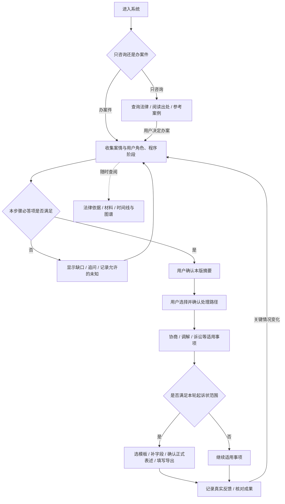

# CivRA 固定流程与可视化改造：现状、分工与对接清单

日期：2026-11-17

核对基线：`develop@922493e`（已合并 PR #12）

独立交付分支：[`codex/guided-workflow-case-visuals`](https://github.com/MillerSWJTU/CivRA/tree/codex/guided-workflow-case-visuals)

前端原型：`frontend/guided-workflow-prototype/`

详细流程设计：`docs/case/guided-workflow-design.md`

本文汇总“有没有修改后端、后端还要改哪些文件、各成员负责什么”及其后关于“相似案例和可视化是否减少”的讨论，并补充本次前端恢复结果。成员编号按新版分工：成员三负责案件业务层，成员四负责 Agent / Runtime。

## 1. 本次到底改了什么

**本次只提交前端交互原型、测试和设计/交接文档，没有改动 Python 后端、数据库或 Agent Runtime。**

上一版固定流程原型已经做出“案情收集 → 确认摘要 → 选择路径 → 办理事项 → 核对成果”。这次把缺失的参考和可视化页面补回，并保留原有进入条件。前端使用浏览器本地存储，尚未连接正式服务。

`develop` 当前前端目录尚无完整 Vue 页面；`feature/frontend` 有 Vue 工程骨架。本分支提供可直接运行的独立原型，后续由成员一迁入正式前端。不能将这次提交理解为完整前后端已经联调完成。

| 内容 | 本分支实际交付 | 仍需对接 |
|---|---|---|
| 固定办理步骤 | 七标签、五步骤、字段规则、明确未知、摘要确认、路径和草稿限制 | Python 统一规则、HTTP 命令、Runtime 状态 |
| 法律依据 | 10 条内置法条的关键词/条号查询、原文、版本、来源 ID、PDF 定位、官方链接、按案件收藏 | 真实 RAG 查询与引用回传 |
| 相似案例参考 | 36 条明确标为模拟的样本；类型、地区、法院、年份、结果、争点筛选；详情、最多三例对比、收藏 | 真实案例语料、检索、来源核验及相似点/差异分析 |
| 案例统计 | 随筛选更新的类型、地区、法院、年份、争点和结果分布；样本数、法院数、年份范围、空结果状态 | 后端核验后的真实样本与统计口径 |
| 本案时间线 | 案情时间与用户操作记录分别标识；程序阶段、处理意向、材料数量 | 后端时间线、事件来源及案件版本 |
| 主张与证据 | 当前请求、事实、材料三栏；用户编辑多对多关联；登记详情；保存与刷新恢复；独立图谱演示案件 | 服务端事实/请求/证据 ID、来源片段、核验状态与持久化 |
| 结果分析 | 确认案情后展示三类情形、待核实前提及当前事实，链接到材料和参考页 | 成员三结果分析工具 + 成员四模型组织 + 成员二依据 |

内置民法典 9 条原文及 PDF 页码已与仓库 `data/processed/civil_code.jsonl` 核对；另含民事诉讼法第145条。原型中的案例、裁判理由和统计全部是界面演示数据，不是检索结果。收藏案例不会把它写入正式文书，也不能用样本比例推算本案胜诉率。

## 2. 软件界面和固定流程

七个标签顺序保持：

**案情沟通 → 法律依据 → 维权路径 → 证据材料 → 结果分析 → 起诉状草稿 → 案情图谱**

| 入口 | 页面内容 | 进入条件 |
|---|---|---|
| 左侧“只咨询法律” | 查条文、看出处、浏览案例参考 | 不要求建立或完整填写案件 |
| 案情沟通 | 对话、字段卡、缺失项、暂不清楚及原因、摘要核对 | 打开案件即可 |
| 法律依据 | 法律条文 / 相似案例 / 本案收藏 | 随时查看 |
| 维权路径 | 适合当前程序的选项、用户确认、办理清单 | 最小必答项满足，且用户明确确认当前摘要 |
| 证据材料 | 登记材料、查看关联；正式版增加 OCR、去重、证据核对等 | 可提前上传和查看；具体生成动作单独校验 |
| 结果分析 | 有利情形、部分支持/争议、信息不足，展示前提和缺口 | 当前分析依据的案情已确认 |
| 起诉状草稿 | 模板、字段、正式表述确认、预览导出 | 案情确认 + 用户选择并确认诉讼 + 适用角色及阶段 |
| 案情图谱 | 案件时间线 / 主张与证据 / 案例统计 | 可查看已有数据；无数据时显示空态 |



原型起诉状首轮限定：交通事故、民间借贷、买卖合同；提出请求一方；尚未起诉；用户已确认诉讼路径。这是本轮产品范围，其他阶段应选择适用文书，不能理解为法律禁止处理其他文书。

## 3. 现有后端已经具备什么

以下是代码存在及契约核对结果，不代表本次跑通了所有真实模型、OCR 和端到端任务。

| 已有能力 | 当前文件 | 后续处理 |
|---|---|---|
| 事实、来源、确认记录、案件快照 | `backend/case/models.py` | 复用；补充新流程字段与兼容规则 |
| 案情摘要、待处理信息、确认/修正准备 | `backend/case/intake/summary.py`、`contracts.py`、`updates.py` | 扩展为明确的案情确认命令 |
| 按场景检查缺失字段 | `data/config/member3_evidence_rules.json`、`backend/case/materials/evidence.py` | 现在主要是证据检查提醒，不能直接当成统一流程门槛 |
| 诉讼文书入口校验 | `backend/case/drafting/contracts.py`、`official_forms.py` | 已要求诉讼状态/路径；仍需叠加统一案情就绪校验 |
| 路径比较、办理清单及反馈 | `backend/case/planning/` | 保留，并适配程序阶段与处理意向分离 |
| 时间线、事实/请求/证据节点与关系 | `backend/case/presentation/visualization.py` | **功能没有被删掉**；前端正式对接时读取其数据 |
| 案例来源及标注核验、过滤和统计 | `backend/case/presentation/statistics.py`、`contracts.py` | **功能没有被删掉**；依赖可核验的案例及标注输入，不等于已有类案搜索 |
| 引用整理与情形分析业务 | `backend/case/research/sources.py`、`knowledge_bridge.py`、`outcomes.py` | 对齐真实检索结果与新前端结构 |
| 案件版本、快照及审计持久化 | `backend/case/storage/repository.py` | 复用现有 SQLite/快照存储，评估兼容迁移；并非“没有数据库” |
| LangChain Agent、等待用户选路、恢复执行 | `backend/agent/runner.py`、`runtime/` | 在现有架构外增加确定性流程控制，无须重新换框架 |
| 会话、消息、SSE、上传与成果下载 HTTP | `backend/api/app.py`、`conversations.py`、`schemas.py` | 增加明确流程命令与状态返回 |
| 法条检索 | `backend/tools/knowledge_tools.py` → `search_statutes` | 可以复用；当前工具尚未提供真实 `search_cases` |

需要纠正两个容易混淆的理解：

1. 现有路径最终仍由用户选择；Agent 决定何时请求显示选路，Runtime 等待用户返回。新设计要固定的是“什么时候允许选路”，不能仅改提示词。
2. v2 曾经缩减的是前端展示。此前成员三的图谱、统计和引用业务没有因此消失。但“有统计模块”不能推导出“已经有真实类案库和检索工具”。

## 4. 后端设计必须统一的规则

### 4.1 最小信息与完整材料分开

建议三档字段规则：

- `known`：必须有明确值、来源和用户确认。例如角色、主要经过、当前程序、处理目标。
- `answered`：必须回应；允许明确未知并记录原因。例如暂未取得事故责任认定、暂不清楚保险。
- `optional`：建议补充，不阻止当前步骤。例如初次沟通时的完整身份证号码。

借贷发生还款后，条件追问已还本金。进入金额计算前再要求明确金额和来源；未知不能当作零或未还款。买卖合同需要补专门收集规则。目前证据配置中的交通/借贷规则不等于完整 intake policy。

现有 `Fact` 不允许 `null` 被标成 confirmed。应另存“用户已回应但事实未知”的记录，不能为了通过步骤伪造确认值。

### 4.2 三个状态维度分开

| 维度 | 含义 | 示例 |
|---|---|---|
| `procedure_phase` | 实际司法程序 | 尚未起诉 / 已立案 / 已开庭 / 判决效力待核实 / 二审 / 执行 |
| `resolution_intent` | 用户当前处理意向 | 协商 / 调解 / 诉讼事项 / 执行和解 |
| `workspace_step` | 应用内步骤 | 收集 / 核对 / 选路 / 办理 / 成果核对 |

当前 `Stage` 与 `selected_route` 有耦合，选择路线会同步改变阶段。因此不能只给枚举增加“已开庭”就算改完。需要调整快照校验、更新命令、工具策略、文书前置条件及旧数据兼容。旧案件的 `litigation` 不能直接推断为已经立案。

实际程序和意向分开后，“已开庭但希望调解”可以同时成立，不应因选择调解而把程序退回诉前。适用条款与正式提示由成员二提供来源、成员三和四共同接入。[民事诉讼法官方全文](https://enipc.court.gov.cn/zh-cn/news/view-6231.html)

### 4.3 由同一业务服务计算门槛

建议新增 `CaseReadinessService`（拟议名称），HTTP、Agent 工具和直接 Python 调用共用。

返回当前案件版本、规则版本、操作、允许与否、阻塞字段、警告、下一步及依据摘要。用户确认绑定相关事实和规则版本。关键事实修改后，重新确认受影响操作；普通进度记录或无关附件上传不应无差别锁回第一步。

服务端校验必须覆盖真正执行入口。前端禁用按钮、Agent 隐藏工具和提示词都不能单独代替它。并发继续使用 `expected_case_version`；额外保存确认依据，识别旧快照、旧草稿和旧 run 恢复。

## 5. 按成员划分：需要改哪些文件

以下为建议责任分配，接口共同维护；不按 Git 作者推断实际负责人。“新增”文件名是建议，尚未实现。

### 成员一：正式前端与应用/API 接入

| 文件或目录 | 需要做什么 |
|---|---|
| `feature/frontend` 中 `frontend/src/views/CaseDetail.vue`、`Chat.vue`、`CreateCase.vue`、`CaseList.vue` | 将本分支七标签、五步骤、字段清单、锁定原因和图谱/参考页迁入正式 Vue 页面 |
| `frontend/src/stores/case.ts`、`types/index.ts`、`api/index.ts`、`router/index.ts` | 统一状态类型；请求服务端 readiness；处理版本冲突、加载/失败/空态与刷新恢复 |
| `backend/api/schemas.py` | 定义咨询/办案模式、流程命令、确认依据与 readiness 响应；与成员三、四共同确定契约 |
| `backend/api/app.py`、`conversations.py` | 提供按钮操作接口，协调已有会话、SSE、上传和成果下载；可信身份来自服务端上下文 |
| `backend/api/README.md` | 写请求/返回、错误码、版本冲突与调用示例 |

API 文件由实际应用层负责人接手；成员二近期也改过该层，正式安排时需要与其确认，避免重复修改。

### 成员二：RAG、真实类案和来源

| 文件或目录 | 需要做什么 |
|---|---|
| `backend/tools/knowledge_tools.py` | 保留现有 `search_statutes`；明确新增真实类案检索契约，不能把法条结果包装成案例 |
| `backend/knowledge/corpus.py`、`retrieval/service.py`、`retrieval/results.py` 及对应索引模块 | 为案例补可检索正文、结构化元数据、过滤和排序；新建案例索引还是扩展现有服务由成员二决定 |
| `data/metadata/`、真实案例语料/标注目录（待确定） | 保存来源 ID、案号、法院、日期、地区、全文/段落、原文链接、版本及统计标注依据 |
| RAG 交接文档 | 说明哪些信息来自原文、哪些是模型摘要；返回适用条件和案例差异所需片段 |

法条检索可以继续复用。要把本次模拟案例界面变成真实产品，则必须补齐真实案例能力。引用 ID、版本和页码要一路传到最终回答，不能只在检索候选里存在。

### 成员三：案件业务层（本组员）

| 文件或目录 | 需要做什么 |
|---|---|
| `backend/case/models.py` | 新增/兼容实际程序、用户意向、未知回应和确认依据；调整旧阶段耦合校验 |
| `backend/case/intake/`：新增 `policy.py` / `readiness.py`，以及新规则配置（建议名称） | 统一字段字典、三档规则、条件必答、缺口原因、动作就绪判定和规则版本 |
| `intake/summary.py`、`contracts.py`、`updates.py`、`history.py` | 摘要确认、事实修正、未知回应、状态更新及审计；关键修改后使相关确认过期 |
| `backend/case/service.py`、`operations.py` | 为所有入口提供相同检查，不只在 UI 或 Agent 里限制 |
| `drafting/contracts.py`、`official_forms.py` | 保留诉讼门槛，叠加角色/阶段/确认依据；重写正式表述后重新确认；可信导出继续由用户操作触发 |
| `planning/routes.py`、`workflow.py`、相关 contracts/models | 按实际程序提供适用路径和办理事项，记录真实反馈；意向变化不伪造程序变化 |
| `storage/repository.py` | 检查新快照字段、历史案件和版本控制兼容；按需要迁移，不必默认重建数据库 |
| `presentation/visualization.py`、`statistics.py`、`contracts.py` | 复用现有图谱和统计，统一节点/关系/过滤/来源契约；未经核验的模拟案例不能混入正式统计 |
| `research/knowledge_bridge.py`、`sources.py`、`outcomes.py` | 接收成员二类案来源，产出本案比较和有依据的情形分析，保留不确定和材料缺口 |
| `backend/tools/case_contracts.py`、`case_client.py`、`case_tools.py` | 与成员四共同接入新参数、门槛和错误返回，防止直接工具调用绕过规则 |

**成员三负责业务规则和工具能力；整体 Agent 调度与等待/恢复由成员四负责。**

### 成员四：Agent / Runtime

| 文件或目录 | 需要做什么 |
|---|---|
| `backend/agent/runner.py` | 接收明确流程动作，协调当前 run 与案件版本；按钮选路和对话选路调用同一命令 |
| `runtime/middleware.py`、`builtins.py` | 按 readiness 限制工具，约束 `request_route_choice` 等入口；收集阶段围绕确定缺口提问 |
| `runtime/state.py`、`backend/common/schemas.py` | 补充流程状态、确认依据、规则版本以及等待用户时所需数据 |
| `case_port.py`、`case_adapter.py` | 调用成员三统一就绪检查、案情确认和路径更新服务 |
| `routing.py`、`model/prompts.py` | 稳定区分只咨询/办案件；提示词解释规则，不替用户确认或跳过门槛 |
| 相关工具适配与恢复测试 | 处理 ask_user / route_selection 等等待状态、旧 checkpoint、重复请求和并发修改 |

现有 `create_agent` 继续保留。固定流程需要确定性控制，模型负责理解、自然追问、检索和解释。

### 成员五：评测与跨模块验收

各开发成员负责自己模块的单测；成员五牵头端到端和比较评测。

| 文件或目录 | 建议补充 |
|---|---|
| `tests/case/`、`tests/agent/`、HTTP 测试 | 未收齐不能选路；摘要未确认不能选路；未选诉讼不能生成对应文书；直接工具不能绕过 |
| 相同测试目录 | 未知不变零；已开庭仍可按适用阶段处理调解；事实/规则变化后旧确认失效；旧 run 不覆盖新案情 |
| `evaluation/datasets/`、`adapters/`、`scoring/`、`configs/` | 明确新增流程任务与引用完整性规则；记录来源、适用条件、案例差异和无法判断原因 |
| `evaluation/results/` | 按现有规则保存可复现结果；模拟前端样本不得当作真实法学评测数据 |

## 6. 先对齐的接口与数据

以下全部为**拟议接口，当前 develop 尚不能直接照此调用**。

| 操作 | 示例契约 | 对接人 |
|---|---|---|
| 查询是否可以进入某一步 | `GET /api/conversations/{id}/readiness?action=select_route` | 三提供判定；一暴露 API；四和五调用 |
| 逐项确认、修正或记录未知 | `POST /api/conversations/{id}/intake-review` | 三定义业务命令；一做按钮；四协调消息与运行状态 |
| 确认摘要、选路、更新真实程序 | `POST /api/conversations/{id}/flow-actions` | 三和四先对齐动作与并发；一接界面 |
| 法条与类案 | 沿用法条结果；类案新增来源完整的返回结构 | 二供数据；三整理业务输出；四组织回答；一渲染 |
| 图谱与统计 | 节点 ID、关系 ID、证据来源、核验状态、过滤条件、样本计数 | 三和二提供可信数据；一展示；五验证 |

写操作应包含 `request_id`、`expected_case_version`、目标动作和对应确认依据；actor 从可信上下文取得。重复提交同一操作返回原结果，案件变化时提示重新核对。

本原型使用 `story`、`principal`、`liability` 等便于设计的字段名。正式对接时要映射到共同字典，例如已有 `loan_principal`、`liability_finding`，不可直接将浏览器整个对象写入 CaseSnapshot。

## 7. 推荐落地顺序与完成标准

1. **三 + 四**：先冻结字段、三维状态、动作及确认依据契约；一、二、五确认各自需要的返回值。
2. **三**：实现统一 readiness、未知回应和业务入口校验，补单测。
3. **四 + 一**：接流程命令、等待恢复和正式 API；前端只展示服务器判定。
4. **一 + 三**：先接现有材料、时间线、图谱、模板和导出能力，保留无数据与出错状态。
5. **二 + 三 + 四**：补真实类案及来源，接比较、统计和情形分析；一替换模拟数据源。
6. **五牵头**：完成跨模块验收，再决定是否合并正式界面。

验收至少覆盖：刷新可恢复、不能跳步、不同阶段不混淆、关键更新使旧确认失效、按案件隔离收藏与材料、来源可追溯、空结果有解释、模拟数据与真实数据分开。

## 8. 同学如何查看这次前端

切换到交付分支后，在 `frontend/guided-workflow-prototype/` 运行：

```sh
python -m http.server 8782 --bind 127.0.0.1
```

浏览器访问 `http://localhost:8782/`。Windows 也可在本目录运行 `启动预览.ps1`。没有 npm 依赖。

建议体验：

1. 第一个交通示例中，查看路径尚未开放的原因；法律依据和图谱仍可查看。
2. 法律依据搜索“第680条”，查看原文和来源；切换相似案例，筛选、对比和收藏。
3. 案情图谱切换案例统计，改变地区/法院/年份，查看样本数与分布同步改变。
4. 主张与证据页点击“打开图谱演示案件”，编辑关系并刷新，观察本地保存。
5. 使用借款诉讼示例查看结果分析；修改关键事实后检查后续步骤重新要求确认。

验证记录见 `frontend/guided-workflow-prototype/验证记录.md`。本次新增与既有规则测试共 19 项通过；浏览器检查记录见该文件。没有因本次前端验证而宣称真实后端联调完成。

本分支独立发布，未合并到 `develop` 或 `main`。团队可先评审界面和契约，再按上述分工实现正式接入。
