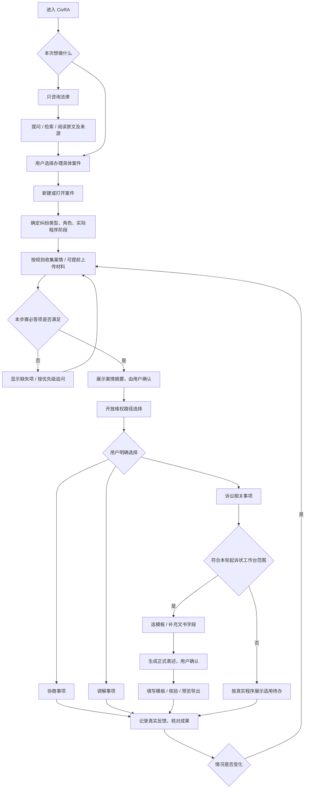

# CivRA 固定办事流程与前端设计 v2（两处参考案例补充）

日期为 2026-11-17。代码基线为 GitHub `develop@922493e`，已包含 PR #12 的 RAG、对话 API 和案件服务重构。交付分支为 `codex/guided-workflow-case-visuals`，未合并到 develop。

本轮产物为代码核对、使用流程方案、可交互前端原型和规则测试。下文明确区分现有实现与建议新增的实现。现有 Python 后端保持原样，新增设计尚未接入生产运行链路。

## 一、对照最新代码，当前到底有什么

| 能力 | 代码与现状 | 对新流程的意义 |
|---|---|---|
| 通用案情事实 | `backend/case/models.py` 的 `Fact` 支持字段名、类型、值、来源、确认状态和被新事实替代的关系 | 可以复用，不需要重写整个案情模型 |
| 明确确认记录 | `Confirmation` 记录消息、确认者、时间。`Fact` 的 confirmed 状态必须有有效值和确认记录 | 用户确认应来自界面操作，不能让模型替用户确认 |
| 案情摘要与待办 | `backend/case/intake/summary.py` 的 `CaseIntakeService.summarize` 返回结构化事实、pending_items、缺失和冲突 | 可作为右侧案情清单的基础 |
| 确认与修正 | 同文件的 `prepare_review` 支持 confirm / defer / dispute / correct，准备更新请求，再交给 `CaseService.update_case` 保存 | 继续沿用显式确认和版本控制 |
| 必查字段配置 | `data/config/member3_evidence_rules.json` 按纠纷类型维护 `required_fields` | 已有部分配置，但目前是证据检查提醒，不是完整的步骤进入规则 |
| 条件追问 | `backend/case/materials/evidence.py` 中，借贷 has_repaid 为 true 时追问 repaid_principal | 可迁移为版本化条件规则 |
| 路径由用户选择 | Runtime 先等待 route_selection，再在 `runner.py` 的 resume 流程读取用户 route_choice | 当前并非由 Agent 直接替用户选路径。主要问题是何时展示选择，仍由模型调用工具触发 |
| 文书的诉讼门槛 | `backend/case/drafting/contracts.py` 的 `DraftDocumentRequest` 要求 stage 和 selected_route 均为 litigation。`OfficialFormService.prepare` 也检查该条件 | “先选择诉讼再生成起诉状”已经存在，需要接到前端并扩展案情完整度校验 |
| 工具阶段限制 | `backend/case/operations.py` 和 `backend/tools/case_client.py` 已检查操作阶段，draft_document 和 build_evidence_directory 只开放 litigation | 可以在此基础上加入字段完整度门槛。通用材料查看与整理是否提前开放需单独梳理，不能误把所有证据操作锁到诉讼后 |
| 用户反馈与办理进度 | `backend/case/planning/workflow_models.py` 已有步骤状态、消息来源、计划版本和办理反馈记录 | 可继续用于选择路径之后的实际办理事项 |
| HTTP 对话接口 | `backend/api/app.py` 已有创建/读取会话、发送消息、SSE、上传和成果下载 | 可复用基本通信，当前没有独立案情确认、readiness 或流程命令接口 |
| 咨询/办案分流 | `backend/agent/routing.py` 和 RunConfig 支持 consultation / case_work，HTTP MessageRequest 尚未暴露显式模式字段 | 前端两种入口需要服务端接收模式并稳定传给 Runtime |

当前缺失配置具体为

- 交通事故检查事故日期 `accident_date`、责任认定 `liability_finding`、保险关系 `insurance`。
- 民间借贷检查本金 `loan_principal`、是否还款 `has_repaid`，已发生还款时增加 `repaid_principal`。
- 这份配置里还没有买卖合同专门 profile，遇到其他类型使用通用检查。
- 当前缺失字段检测接受已知且非全 disputed 的候选记录，`summarize` 另行列出 unconfirmed。这两者都不等于“用户确认完毕后才允许选路”。

## 二、主流程



法律查询、材料上传和查看已有记录可以穿插进行。进入新的办理动作由服务器规则决定。缺失信息不会自动变成已确认，暂不清楚也不会转换成否、零元或不存在。

“完成案情收集”表示满足当前操作需要的最小信息范围。它不要求一次收齐所有法律要件、证据或正式文书字段，也不表示已经认定责任。

## 三、字段如何设置必填

应新增独立的 intake policy，不直接把证据检查的所有 required_fields 变成硬性关卡。三种收集级别如下。

| 级别 | 通过条件 | 例子 |
|---|---|---|
| 必填且确认 `known` | 有明确值，用户已确认，来源有效，相关冲突已解决 | 用户角色、主要经过、实际程序阶段、处理目标 |
| 必须回应 `answered` | 已确认具体值，或用户明确表示未知并留下原因 | 事故责任认定、保险、事件的大致时间和地点 |
| 建议补充 `optional` | 不阻止本步骤，缺少时保留提示 | 初次沟通时的完整身份号码、精确金额、全部证明材料 |

系统使用字段键、提示、适用纠纷、目标操作、级别、条件、未知处理办法和规则版本来配置。确定性程序计算缺口，Agent 可以把问题说得自然、提取候选信息，但不能自行取消必答项或设置已通过。

### 进入路径选择前的默认规则

以下是产品设计建议，不是法定立案条件。

| 信息 | 默认要求 | 当前数据承载与改动 |
|---|---|---|
| 纠纷类型 | 必填且确认，可选择“其他/待进一步分类”进入通用流程 | 已有 `CaseSnapshot.dispute_type`，要补可信元数据更新入口与确认记录 |
| 我的角色 | 必填且确认 | `Fact.field` 可扩展，统一键名并对接成员四 |
| 对方及双方关系 | 必填且确认，可先用身份描述或称呼 | 可复用姓名字段并新增关系描述，暂不强制身份证号 |
| 主要经过与争议 | 必填且确认 | 原文保留在 statements，结构化摘要保存为带消息来源的 Fact |
| 发生时间 | 必须回应，可说明未知，允许大致时间 | 现有 date 类型要求 YYYY-MM-DD。大致时间用 text 字段并记录精度，不能伪造成具体日期 |
| 相关地点 | 必须回应，可说明未知 | 单独保存事件、住所、履行地点。已有 jurisdiction 不能直接当作用户所在地 |
| 实际程序阶段 | 必填且确认 | 新增独立 procedure_phase，当前 stage 不能完整表达 |
| 希望解决什么 | 必填且确认 | 已有 user_goals 与 claims，需明确更新方式、确认来源及后续结构化请求转换 |
| 交通事故责任认定、保险情况 | 必须回应，允许暂不清楚 | 复用已有字段，未知原因与“用户已回应”另存 |
| 借贷本金、是否发生还款 | 必须回应，允许暂不清楚 | 金额计算时另加 known 条件，不能把未知还款作为未还款 |
| 已还本金 | has_repaid 明确为 true 时必须回应 | 沿用现有条件逻辑，余额计算前要求明确金额及来源 |
| 买卖标的、主要约定、履行情况 | 必须回应 | 新增买卖合同收集 profile，暂不声称已有完整专门规则 |

进入赔偿计算时，再要求对应金额、范围、去重处理和有效来源。进入具体文书预览时，再要求适用模板和已确认请求。每一步有自己的门槛，不用一个全局“100%完整”覆盖所有任务。

### 未知和已确认要分开

现有 Fact 不允许把 `value=null` 标成 confirmed。因此应另存 `IntakeFieldResponse` 一类记录，表达“用户已回答，但该事实目前未知”，包含字段键、原因、message_id、actor_id、时间和版本。该记录只满足允许未知的收集规则，不能被金额计算或正式文书当作已知事实使用。

## 四、程序阶段、处理意向、应用步骤分开

目前 `Stage` 为 consultation / route_selection / negotiation / mediation / litigation / closed，且模型校验要求活动阶段与 selected_route 一致。`set_case_stage` 选择路线时同时更新二者。这套字段表达的是旧运行阶段，无法同时清晰记录“已开庭”和“希望调解”。

建议新增三个互不替代的维度。

| 维度 | 例子 | 谁决定 |
|---|---|---|
| 实际程序 `procedure_phase` | 尚未起诉、已立案未开庭、已开庭未判决、已判决效力待核实、二审中、生效、执行中、结束 | 根据用户明确反馈和材料记录 |
| 当前意向 `resolution_intent` | 协商、调解、诉讼事项、执行和解 | 用户在当前允许的选项中明确选择 |
| 产品步骤 `workspace_step` | 收集、核对、选路、办理、成果核对 | 依据状态和进入规则推导，不能代表真实司法进度 |

旧字段先保留供现有调用方使用，新增独立字段后逐步迁移。不能仅扩大 Stage 枚举就算完成，必须同步修改 CaseSnapshot 校验、route choice 写入、工具阶段策略、文书请求、历史记录与测试。旧案件的真实程序未知时显示待确认，不能由 litigation 直接推断已经起诉或立案。

开庭后、判决前仍可调解。二审可调解，执行中应呈现执行和解。依据民事诉讼法第145条、第179条、第241条。选择这些意向不会回退程序阶段。[最高人民法院发布的现行民事诉讼法](https://enipc.court.gov.cn/zh-cn/news/view-6231.html)

原型将 execution + negotiation 显示为“执行和解”仅用于交互演示，正式后端应使用明确的独立枚举/子类型，避免语义混淆。

## 五、七个功能如何安排

左侧保留案件列表，增加“只咨询法律”。每个案件中保留原来的七个标签顺序。上方新增五步进度，右侧为案情清单，中间保留对话与当前待办卡。

| 顺序与功能 | 开放条件 | 内容与交互 |
|---|---|---|
| 1 案情沟通 | 新建案件即可 | 对话、字段卡、缺口、暂不清楚、来源、用户确认。一次优先问一至两个问题 |
| 2 法律依据 | 随时 | 查询、原文、条号、版本、来源定位。检索与案情完整度分开 |
| 3 维权路径 | 当前规则通过 + 本版摘要用户确认 | 显示适用于真实阶段的选择。点选后明确确认，再进入办理清单 |
| 4 证据材料 | 随时上传、查看 | 识别、归类、去重核对、证据目录、费用整理、补证清单。部分生成动作有各自门槛 |
| 5 结果分析 | 用户已确认分析所依据的最小案情 | 条件情形、支持/不利材料、缺口、引用。信息不足时输出缺口，不生成无依据的确定结论 |
| 6 起诉状草稿 | 案情已确认 + 用户明确选择诉讼 + 适用角色和文书阶段 | 选择模板、补充字段、正式表述确认、填原表、核验、预览和导出 |
| 7 案情图谱 | 随时查看已有数据 | 时间线、请求与证据关系、历史变更、相似案例视图。无数据时显示空态 |

标有锁的标签仍可以点击，点击后显示具体未满足的条件和直达补充位置。它不触发受限业务动作。实际执行时，后端必须重新核验。

原型首期起诉状页仅覆盖尚未起诉且提出请求的一方。被诉方、已立案补正、反诉、上诉、执行申请等应根据任务选择适用文书，不能全部套用同一个起诉状。这属于本轮产品范围。

## 六、正式后端应新增的统一门槛

建议由成员三实现 `CaseReadinessService` 和版本化 intake policy，供 HTTP、Agent 工具和其他 Python 调用方共用。

```json
{
  "case_version": 8,
  "ruleset_version": "intake-v1",
  "basis_hash": "服务端计算的相关字段与规则摘要",
  "action": "select_route",
  "allowed": false,
  "blockers": [
    {"field": "user_goals", "reason": "missing", "question": "你希望解决什么？"}
  ],
  "warnings": [],
  "next_action": "complete_intake"
}
```

此处为拟议返回结构，当前 API 没有该响应。服务端要统一处理 missing / unknown / unconfirmed / disputed / conflict / stale / excluded_source。结果不仅是百分比，还包含阻塞字段、原因、可执行动作和修正位置。

确认绑定字段依据与规则版本，保留完整审计。修改关键事实、诉求、角色、程序阶段、规则版本或排除相关来源后，重新确认所影响的操作。只上传无关附件或写入普通进度记录不应无差别把所有功能锁回第一步。并发控制继续使用 expected_case_version，基于相关内容的 basis_hash 用于判断确认或成果是否过期。

规则评估失败或配置缺失时返回清楚的错误，保持阅读和保存草稿可用。不得默认为已满足办理条件。

## 七、拟议接口与 Agent 行为

以下路径为待实现设计，不是当前可直接调用的接口。

| 拟议操作 | 责任与规则 |
|---|---|
| `GET /api/conversations/{id}/readiness?action=select_route` | 返回服务端规则、字段状态、门槛和下一步 |
| `POST /api/conversations/{id}/intake-review` | 明确确认/修正/暂缓/记录未知，保存用户操作消息，调用现有 prepare_review + update_case |
| `POST /api/conversations/{id}/flow-actions` | 统一接收 confirm_intake / select_route / update_procedure 等有限命令，服务端校验适用条件后保存 |
| 扩展会话创建/消息模式 | 接受受控 consultation / case_work 或 mode，交给 Runtime。不得信任前端提供 tool list、actor、可信确认状态 |
| 现有 files / messages / events / artifacts | 继续复用。按钮型动作需对应明确业务命令，不能仅发送自然语言“我选择诉讼”并期待模型正确改变状态 |

每个写命令包含 request_id、expected_case_version、目标操作、用户输入及对应快照/确认依据。actor 由可信应用上下文提供。重复请求同一内容返回原结果，不同内容复用请求 ID 拒绝。版本变化返回冲突，重新读取再确认。

运行中或等待 ask_user / route_selection 时，要统一协调当前 run。确认案情与选路不能与旧 checkpoint 的恢复同时产生双重写入。对话里的选择和按钮里的选择必须调用同一服务端命令。进入条件拒绝可使用明确 `flow_not_ready` 错误与 blockers，不能只抛一般异常。

Agent 在收集阶段只获得当前允许的工具和字段缺口。它可以提问、读材料、查依据、提取未确认候选和解释选项。满足规则后由系统提供“确认摘要”，用户确认后系统开放选路。`request_route_choice` 也要检查相同门槛，不能留下自然语言绕过入口。用户选择后才给予对应动作，模型调用业务工具前仍执行服务端校验。

旧有咨询模式当前允许 request_route_choice，新增模式需要明确“转入案件办理”后先走案情步骤。已有 LangChain create_agent 可以继续保留，固定流程由外层确定性状态与业务检查控制，不要求把所有自然语言能力改成机械脚本。

正式文书导出继续沿用 OfficialFormService 的可信 confirm_and_export，不将最终确认开放为 LLM 自行执行的工具。先保存确认消息、核对预览版本，再填写原表与导出，保留未知和来源。重写表述需重新确认。

## 八、按分工落地

| 成员 | 具体工作 |
|---|---|
| 成员三（你） | 必填/条件必填规则，统一字段字典，readiness，案情摘要与显式确认，未知回应记录，程序阶段与处理意向，业务动作检查、文书校验与状态失效规则 |
| 成员四（Agent / Runtime） | 外层固定流程，按门槛限制工具，追问缺失字段，明确模式入口，route_choice 与 flow-actions 的统一、等待恢复和 checkpoint 版本协调 |
| 成员一（前端及应用接入） | 七标签、五步骤、字段卡、锁定原因、按钮请求、进度刷新、SSE、正式 API 路由与鉴权接入。以实际 API 负责人为准，不能根据文件作者自动认定工作归属 |
| 成员二（RAG） | 法律与程序依据来源、全文、版本和定位，阶段适用资料。法律咨询继续独立可用 |
| 成员五（评测） | 未收齐不能选路、未确认诉讼不能生成文书、未知不计零、开庭后调解、不越权跳步、规则与案件版本变化、旧 run 恢复等集成测试 |

先由成员三和四确认字段与动作契约，再实现统一 readiness 与写命令，接上当前 Runtime，最后迁入成员一的 Vue 工程。前端只展示服务端状态，避免 Python 和前端各维护一套正式规则。

## 九、本轮完成与未完成

本轮已完成最新 develop 的独立工作副本、代码能力核对、上述设计、可点击原型，以及 15 项规则与参考数据测试。原型包含咨询入口、三类纠纷收集字段、条件追问、摘要确认、路径锁定、用户选路、草稿确认与导出示例、事实变更后重新核对，以及“已开庭但想调解”的示例。

最终按用户确认恢复第二版整体布局：仅在结果分析原三张卡片下增加参考案例，在案情图谱原时间线下增加可展开的参考案例/筛选/统计区。其他页面恢复第二版；不保留上一轮的全局案例入口、收藏、图谱子标签和关系编辑 UI。案例全部标为模拟，真实类案检索仍需成员二补齐。原有后端图谱与统计模块保留。具体后端文件分工见 `docs/case/CivRA_固定流程与可视化改造_成员对接清单.md`。

尚未实现新的 Python readiness 服务、数据库迁移、正式 HTTP 流程命令、Runtime 接入和 Vue 正式页面。OCR、RAG、费用计算、官方原表填充等现有后端能力尚未连接此原型。该范围不应标为整套新系统已完成。

### 代码核对记录

已核实 Fact、CaseSnapshot、CaseIntakeService、证据规则配置、OPERATION_STAGES、文书契约、OfficialFormService、runner 路线恢复、MessageRequest 和 API 现有路由。已用本次独立副本导入 evidence_rules，确认默认路径与显式路径均可加载 `case-evidence-rules-0.3.0`。没有运行全套后端、真实模型或 OCR 联调，因此不据此宣称最新分支全部测试通过。
