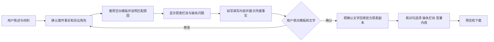

# 北京法院官方模板库与帮选帮填接口

下载的226个DOCX已按下载清单逐项核对SHA256、字节数、ZIP CRC及document.xml，共113份空白表和113份填写实例，约7.30MB。资源放在 `data/templates/official/bjcourt/`，版本由原文件哈希确定。导入脚本为 `scripts/case/import_official_templates.py`，重复导入相同清单会核对已有库，内容不同则报错。

## 存储职责

| 位置 | 内容 | 用途 |
| --- | --- | --- |
| `data/templates/official/bjcourt/blank/` | 113份官方空白原件 | 按ID和明确版本读取并生成填写副本 |
| `data/templates/official/bjcourt/example/` | 113份官方填写实例 | 人工理解填写格式，实例人物、金额等不作为案件事实 |
| `data/templates/official/bjcourt/catalog.json` | 标题、领域、文书类型、来源URL、下载时间、校验哈希及首批字段位置 | 推荐模板与定位原表栏目 |
| 现有案件数据库与资产存储 | 本案填写预览、确认记录、生成文件 | 沿用案件版本、历史和资产下载接口 |

原始下载目录作为收集档案保留。模板文件随项目资源部署，案件数据库保存本案引用的模板ID和版本，及用户确认后的输出。当前资源总量很小，无须为模板另建数据库。

库内同时保留民事、行政、刑事、国家赔偿和其他程序文书。首批自动推荐及回填只启用交通事故、民间借贷、买卖合同三类民事起诉状。房屋租赁等仍有原件，可后续扩展，当前不会推荐为已支持的填写流程。

## 用户流程



界面建议放在第9部分“文书生成”中，组织为“选择模板、填写与确认、预览下载”三个步骤。文件上传仍由材料功能负责。成员三提供表格栏目、建议文字、事实引用和缺失问题，成员一把它们展示为可逐项核对的表单。

## Python入口与Agent工具

`CaseService` 已创建 `service.official_forms`。

- `recommend(request)` 根据案件已记录的纠纷类型和原告角色返回候选模板，返回值中的 `version` 必须随后明确传入。
- `prepare(request)` 校验案件版本，读取原件哈希，生成栏目组、建议文字、所据事实ID、待补充问题和确认内容，保存为本案输出。
- `confirm_and_export(request)` 供受信任的应用确认入口调用。核对本案已存用户确认消息与预览完全一致，确认事实未变化，再生成DOCX并将文件和结果原子保存到现有资产库。

Agent扩展工具通过 `OfficialFormToolClient.contracts()` 获取JSON Schema，两个工具名为 `recommend_official_templates` 和 `prepare_official_form`。成员四显式将其加入自己的工具注册表。调用 `invoke(name, context=..., case_version=..., arguments=...)` 时，context和案件版本由应用提供。

应用确认入口不注册为LLM工具。成员一在用户点击确认后，通过现有 `RepositoryCasePort.record_user_reply(...)` 保存服务返回的 `confirmation_text`，随后调用 `confirm_and_export`，传入新的案件版本和该消息ID。界面展示模板名称和完整拟填写内容，机器确认串可由应用保存，无须让用户复制哈希。普通的“同意”文本不能代替对明确版本预览的确认。

```python
from backend.tools.official_forms import OfficialFormToolClient

tools = OfficialFormToolClient(service.official_forms)
recommendation = tools.invoke(
    "recommend_official_templates", context=context,
    case_version=case_version, arguments={"role": "plaintiff"},
)
card = recommendation.data["candidates"][0]  # 实际界面展示候选供用户核对
preview = tools.invoke(
    "prepare_official_form", context={**context, "request_id": "preview-1"},
    case_version=case_version,
    arguments={"template_id": card["template_id"], "template_version": card["version"]},
)
```

现有10个成员五评测工具保持其协议，新增工具是单独启用的扩展组。正式运行时成员四还需将调用写入预算与轨迹。原表DOCX通过现有 `service.assets.get_artifact(case_id, artifact_id)` 获取，鉴权仍由成员一入口处理。

## 正式措辞与现阶段边界

注入 `MeteredFormWordingGateway(call_model)` 到 `CaseService(..., form_wording_gateway=...)` 后，可用成员四计量过的模型拟写文字。模型输入包含原表字段组和已确认且未被冲突检查排除的事实，返回每组文字和事实ID。结构检查会拒绝未知字段、未知事实和重复字段，语义是否忠实仍需用户及后续核验确认。

未注入真实模型时，仅把少量明确映射的已确认事实按标签整理到事故经过、责任认定、保险、合同签订等栏目，其余保留问题。未知项不自动填零或“无”。纠纷类型未知、应诉方、未支持案由会返回需要补充信息或尚未支持。

首版回填采用字段组追加文字。原表提示、表格、样式及其他OOXML包部件保留，填写内容进入相应回答单元格，必要时允许行高扩展。尚未逐个拆分姓名/地址等细项，复选框、签名和重复当事人栏尚待处理。已填写结果仍为 `needs_review`，缺失字段继续列明。本次原表导出提供DOCX，原有独立填写草稿仍支持Markdown/Word/PDF，原表的固定版式PDF转换尚待接入。

## 对接与验证

| 成员 | 本次可用内容 | 下一步对接 |
| --- | --- | --- |
| 1 | 候选卡片、字段组、建议文字、问题、确认串、资产ID | 三步文书界面、用户消息记录、授权下载 |
| 2 | 官方模板来源URL与明确文件哈希 | 实体法律依据及引用核验，区分表格示例与法律来源 |
| 4 | 两个新增工具契约、受限模型网关 | 注册工具、传入真实模型、预算轨迹、追问与恢复流程 |
| 5 | Python入口、三类原表、合成演示 | 模板推荐正确率、事实忠实度、缺项识别、确认边界、原表回填核对 |

测试为 `python -m unittest discover -s tests/case -p test_official_forms.py -v`。合成演示为 `python scripts/case/demo_official_forms.py --output output/official-form-demo-new`，输出目录必须不存在。演示中的用户确认仅用于合成数据，生产界面必须等待真实用户操作。

2026-11-10验证：新增6项专项测试通过，三类原表均走通推荐、预览、应用记录确认、原表回填、资产取回；完整374项回归中356项通过、18项因共享Runtime缺失而跳过。已核对三类合成样稿的实际回填页面。真实模型和完整用户界面尚未参加此次验证。
