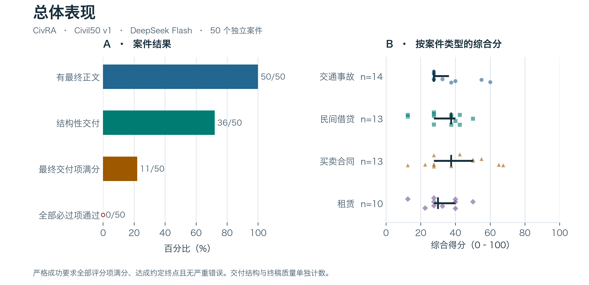

# CivRA Agent · Civil50 评测报告

**评测日期：2026 年 11 月 23 日（香港时间）**

**运行版本：CivRA `feature/guided-delivery@3c917e4` · Civil50 `0b76721` · DeepSeek Flash 非思考模式**

[18 张结果图](figures/) · [整本矢量图册](Civil50_图册.pdf) · [分组分子与分母](报告数据.csv)

## 主要结果

50 案均产生了非空最终正文。36/50 达到结构性交付终点，11/50 的最终交付项获满分，0/50 同时满足 Civil50 的全部必过项。加权总分均值为 **34.55/100**（SD 12.83），中位数为 **27.5**（四分位数 27.5、40.0）。四类案件的结果见下表。[案型比较](figures/02_case_types.png)与[逐案评分矩阵](figures/04_case_score_matrix.png)给出了分组和单案结果。

| 案件类型 | 独立案件 | 案由命中 | 关键追问覆盖（预标同义词） | 最终交付项 2 分 | 结构性交付 | 综合均分 |
| --- | ---: | ---: | ---: | ---: | ---: | ---: |
| 交通事故 | 14 | 9/14 | 4/28 | 3/14 | 9/14 | 33.75 |
| 民间借贷 | 13 | 10/13 | 4/26 | 1/13 | 8/13 | 32.50 |
| 买卖合同 | 13 | 12/13 | 6/26 | 3/13 | 10/13 | 39.42 |
| 租赁 | 10 | 0/10 | 2/20 | 4/10 | 9/10 | 32.00 |
| **全组** | **50** | **31/50** | **16/100** | **11/50** | **36/50** | **34.55** |

案由命中取选路线前的结构化字段。当前案由枚举将本批 10 道租赁题归为“其他”。在要求四分类的统计口径下记为未命中。终稿 0/1/2 分分布为 **0/39/11 案**。其中 20 个咨询任务均交付正文，10 个协商和 10 个调解任务各有 8 个结构性交付，10 个诉讼准备任务中 1 个保存了证据目录，均未同时交付可读起诉状。13 案明确记录缺项并受阻，1 案达到 20 轮上限。

## 交互、检索与工具

| 指标 | 结果 | 对应图 |
| --- | --- | --- |
| 独立案件与实际交互 | 50 个会话，33 案提交超过一轮，全组 236 次用户提交 | 05、06、12 |
| 字面关键词 / 含同义词 | 3/94、25/94 个实际发问命中。首轮含同义词 7/8，后续 18/86 | 05 |
| 来源与回复 | 模型发问命中 10/14，系统卡片命中 15/80。实际披露 14/100 项，上传 4/100 份预置摘记 | 05、14 |
| 推进与变更 | 答复后可观察的结构推进 122/148。预定修订 9/16 实际触发，8/9 返回同一步且内容发生变更 | 14 |
| 业务工具 | 350 条调用记录，243 次成功、21 次条件不足、86 次错误或拦截；Runtime 记录 346 次实际尝试 | 08、18 |
| 法条 RAG | 46/50 案调用检索，共 112 次。首检 P@5 为 72/230（31.3%），其中 201 个排名位有实际返回 | 09、10 |
| 参考法条召回 | 首检前五 16/41（39.0%）；全程累计 23/41（56.1%） | 09 |
| 检索上下文 | 586/586 个返回候选曝光可在后续模型请求中定位原文与来源 ID，138/586 属预标相关 | 09 |
| 结构化来源 | 22/50 案输出结构化引文。91 个配对中，68 个对应检索过的预标条文，2 个能逐字定位到答案主张并追至已检索来源 | 13 |
| Agent 在线类案查询 | **N/A**。工具目录无在线类案检索，本批无可判断调用 | 11 |
| 前端类案推荐 | 对既有 9 条固定案例，首轮 2/2 张返回卡相关，结案快照 13/21（61.9%）。在 17 道库中有预标相关卡的案件里，首轮命中 2/17，结案快照命中 13/17 | 11 |
| 效率 | 548 次主模型调用，主 Agent 合计 8,453,821 Token；每案活跃耗时中位数 35.09 秒（Q1 9.40、Q3 47.16） | 12、17 |

77/86 次调用错误发生在 `update_case`。其中 44 次试图原地修改已保存事实，25 次试图在缺少对应用户答复时写入未知字段。案例 024 在重复询问本金与已还款的组合问题时达到轮次上限。同义词控制器反复匹配已经披露的还款字段，本金仍未取得。这一现象与后端字段门槛和控制器的组合问法匹配都有关。

## 如何运行与判分

- **样本与版本。** 从私有 GitHub 归档的同一提交读取 50 个独立案件家族，10 案开发、40 案待独立评审。每案预先固定咨询或三种办理路线之一，共 20/10/10/10 案。评测使用同一份 1,690 条法条向量索引和 BAAI/bge-m3 查询嵌入。记录了实际运行的代码、数据、索引与控制器哈希。
- **交互与隔离。** 测试手册提供了开场、答复、上传、核对、修订和停止的操作口径。这里由本地控制器通过生产 ASGI 接口操作后台，真实 Agent 与检索照常运行。首轮只发开场白，之后只披露匹配到的角色卡内容和材料，评分表与原始源记录留在本地评审侧。选路和正常核对按真实 API 状态执行。每个会话最多接受 20 次提交，重复未变待办两次后停止。未发送以点名工具推进的救场提示，也未模拟已付款、已签署或已立案的事件。
- **控制器修正。** 初批运行发现长句形式的未知答复在部分结构化卡片上无法按未知解析。按已发送答复是否触发该问题，从初批程序化筛出 30 案，另开会话，使用卡片提供的“暂时说不清”“暂时没有”或案型选项复测。主分析纳入 20 个不受影响的原始会话与 30 个复测会话，每案恰好一次。两批运行均保留，未依据得分选择会话。图中的交互、耗时、调用与 Token 为主分析会话合计。
- **任务质量。** 使用固定的 20/15/20/20/25 五维权重。先按 0/1/2 给 S1–S7 逐项评分，维度内除以满分后按权重合成百分制。S4（依据与限制）和 S6（最终交付）由 Codex 逐案复核，并在评分表保留理由。其他项用录得的提问、材料、定位、上下文及可见文本判定，属于保守的证据规则。严格成功要求所有必过项满分、指定成果通过且无严重错误。结构性交付只看会话状态与成果，Word 检查以下载成功、ZIP 可读并包含主文档为证。
- **关键词与多轮。** 字面命中要求出现数据集意图词。同义词命中使用运行前固定的规则。问题命中率以实际提出的 94 个问题为分母，逐案缺口覆盖按每案两项共 100 项计，重复不重复加分。这里统计的是词表匹配，范围比测试手册中的全部有效问题更窄。系统询问姓名或一般流程可能有用，但不计为命中指定缺口。案例 030 的“退给”未命中当时的退款词表，说明词表也会漏判。答后推进以新字段、步骤、成果或可见终点为证，按结构变化统计。
- **RAG 与引用。** Precision@5 按每案第一次查询的实际前五位计算，相关性来自本地预标条文集合，重复候选与空位不计命中。有 46 案发出查询，故分母为 230。召回按原数据集的 41 条正标签参考条文逐题核对版本化 ID，没有调用的适用题计漏。参考标签多为现行版本对照，有历史法时仍需逐案核对时间效力。上下文统计要求 ID 与完整正文同时出现在紧接的可读取模型请求。对 91 个结构化配对检查了出处和原文定位，完整的法律支持率仍需要对主张逐句复核。
- **类案。** 前端可在案情图谱中本地匹配 9 条公开卡片，脚本将首轮原话和结束快照分别交给原版推荐函数。相关标签按争点与卡片覆盖关系预标，与产品自身词表分开。13/21 是实际返回候选精度，13/17 是有已标相关卡片案件的命中，租赁无覆盖。离线 Civil50 类案候选不算 Agent 在线召回。
- **统计边界。** 本轮是单次、非随机样本的描述性评测。未做跨模型对照或显著性检验。40 个候选题及评分仍待独立复核。接口评测覆盖真实业务状态，手册中的浏览器刷新、切案和附录异常用例没有作为额外的独立测试。主 Agent Token 不含嵌入和由业务网关另行产生的调用。未核到统一计费日志，费用保持未知。

## 图表索引

| 图号 | 内容 | 图号 | 内容 |
| --- | --- | --- | --- |
| 01 | 总体表现 | 10 | 首检排名位相关性 |
| 02 | 四案型命中、回答、得分 | 11 | 前端类案覆盖、精度与在线能力 |
| 03 | 五维评分 | 12 | 轮次、工具、模型与耗时分布 |
| 04 | 50 案逐项评分矩阵 | 13 | 终稿与引用可定位性 |
| 05 | 关键词覆盖与轮次命中 | 14 | 材料披露与修订推进 |
| 06 | 逐案交互轨迹 | 15 | 案由分类矩阵 |
| 07 | 目标路线与结构性交付 | 16 | 开发集与待评审集 |
| 08 | 工具调用次数和返回状态 | 17 | Token 用量与长尾 |
| 09 | 法条检索、参考召回与上下文 | 18 | 工具错误原因 |

## 复核资料

[分组统计](报告数据.csv)保留指标的分子和分母。[逐案评分](tables/case_scores.csv)、[350 条分项评分](tables/rubric_items.csv)、[追问命中](tables/questions.csv)、[多轮交互](tables/turns.csv)、[工具统计](tables/tools.csv)、[法条候选统计](tables/statute_candidates.csv)、[引文定位统计](tables/citations.csv)与[类案推荐统计](tables/frontend_candidates.csv)以案例编号和指标供复核。另见[共享范围](SHARING_SCOPE.md)。

资料来源为 [Civil50 v1 数据和金标准草稿](https://github.com/Jerry-Xiong1106/Civil50/tree/0b7672100d9457a093b85ec7d81b873ae7d66115)、[CivRA 固定提交](https://github.com/MillerSWJTU/CivRA/tree/3c917e4f6217679f2e431097fe193602cb159256) 与用户提供的《CivRA 多轮交互测试手册(2)》（SHA-256 `e6ba06659f715a1758fac492465e055a57a4fd83d77cddcbe179a97f96b88297`）。制图使用 Matplotlib 3.11.2，并参考 Scientific Agent Skills 的统计与制图指南。Kassis, T., Agarwal, V., He, Y., Patel, D., & Brueckner, A. M. (2026). *Scientific Agent Skills: A Library of Procedural Knowledge for Research Agents*. [arXiv:2609.00065](https://doi.org/10.48550/arXiv.2609.00065)
